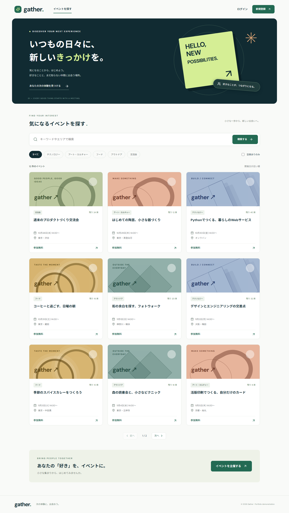

# Gather — イベント予約Webサービス

[](https://github.com/qedhourse580/gather-event-booking/actions/workflows/ci.yml)

イベントを探し、予約・キャンセルまで行えるWebアプリケーションです。主催者はイベントを作成・公開し、予約状況を確認できます。

**Python / Django REST framework / React / TypeScript / PostgreSQL** で、利用者向け画面からAPI・DB・CIまでを実装した個人開発のポートフォリオです。掲載イベントは架空です。現時点で一般公開の稼働URLはありません。以下の手順でローカル起動できます。



## できること

| 利用者 | 機能 |
|---|---|
| 未ログイン | 公開イベントの一覧・詳細、キーワード・カテゴリー・場所・空席による検索 |
| 一般ユーザー | ユーザー登録、ログイン、自分の予約一覧、予約・キャンセル・再予約 |
| 主催者 | イベント作成・編集・公開、定員・締切管理、自分のイベントの予約者一覧 |

主催者も一般ユーザーの機能を利用できます。登録時に主催を希望しても、Djangoの管理者権限は付与されません。

> デモのため、登録時に主催者を選べば誰でも主催者になれます。本番では、運営による承認や本人確認を経て主催者権限を付与する想定です。

## 実装で重視したこと

### 残り1席に同時に予約されても、定員を超えない

予約・キャンセル・主催者の定員変更は、同じイベント行を `SELECT ... FOR UPDATE` でロックします。ロック後の最新の定員・予約人数を確認し、予約と人数カウンターと履歴を同じトランザクションで更新します。

- 残り1席に6ユーザーが同時予約：成功1件、競合5件。
- 同一ユーザーの同時予約：予約は1件、人数の増加も1人分。
- 同時にキャンセルが届く：空席は1人分だけ戻す。

この3シナリオを**実際のPostgreSQL**でテストしています。SQLiteでは行ロックを検証できないため、同時実行テストはスキップします。

実装：[services.py](backend/booking/services.py) / 検証：[test_concurrency.py](backend/tests/test_concurrency.py)

### データの所有者をAPI側で確認する

画面上のボタン表示に加えて、APIで対象データを制限します。他人の予約や別の主催者のイベントを、IDを変更して読み取り・更新できないようにしています。権限外の対象は404で返します。

### 開催中止は元に戻せない状態として扱い、予約を自動でキャンセルする

公開状態は「下書き⇔公開」「公開→開催中止」だけを許可し、開催中止は終端にしています。開催中止にすると、同じ行ロックの中で有効な予約をすべてキャンセル扱いにし、予約数を0に戻し、履歴に「開催中止によるキャンセル」を残します。編集で日時を変える場合は開始日時が未来であることを確認し、日時を変えない編集（タイトルの修正など）は開始後でもできるようにしています。

実装：[models.py](backend/booking/models.py)・[services.py](backend/booking/services.py) / 検証：[test_event_lifecycle.py](backend/tests/test_event_lifecycle.py)

### 失敗した操作を、画面からやり直せる

入力エラー、満席、締切、通信失敗、検索結果なしを表示します。検索条件はURLに保持し、リロードや共有でも再現できます。予約競合時には最新の残席を再取得します。

### Djangoの標準機能を使い、業務ルールを明確に分ける

認証・パスワード管理・ORM・マイグレーションはDjango、JSON APIはDRFを利用。予約処理はサービス層にまとめ、API・DBの制約・テストの役割を分けています。運営用Django adminは、予約データの直接書き換えで整合性を崩さないよう閲覧中心にしています。

## 技術構成

| 分野 | 技術 |
|---|---|
| バックエンド | Python 3.12、Django 5.2 LTS、Django REST framework |
| フロントエンド | React 19、TypeScript、Vite、React Router、Lucide |
| DB | PostgreSQL 17（SQLiteは簡易起動用） |
| 認証 | Djangoセッション認証、HttpOnly Cookie、CSRF検証 |
| API仕様 | drf-spectacular / OpenAPI / Swagger UI |
| テスト | pytest、pytest-django、Vitest、Testing Library、Playwright |
| コード品質 | Ruff（Python）、ESLint・Prettier・TypeScript（フロントエンド） |
| 実行環境 | Docker Compose、Gunicorn、Nginx |
| CI | GitHub Actions：PostgreSQLテスト、仕様書検証、ビルド、E2E、コンテナ起動確認 |

## 起動：Docker Compose

前提：Docker Engine / Docker DesktopとDocker Composeを利用できること。

```bash
git clone https://github.com/qedhourse580/gather-event-booking.git
cd gather-event-booking
cp .env.example .env
```

`.env`の `POSTGRES_PASSWORD` と `DJANGO_SECRET_KEY` をそれぞれランダムな値に変更します。生成例：`python -c "import secrets; print(secrets.token_urlsafe(48))"`。`.env`はGit管理対象外です。

```bash
docker compose build
docker compose run --rm backend python manage.py migrate --noinput
docker compose run --rm backend python manage.py seed_demo
docker compose up -d --wait
```

- アプリ：<http://localhost:8080/>
- API仕様：<http://localhost:8080/api/docs/>
- ヘルスチェック：<http://localhost:8080/api/health/>

`seed_demo`はサンプルイベントと `visitor` / `organizer` を作成し、新規デモアカウントのパスワードをその場で表示します。再実行しても既存データやパスワードを上書きしません。自分で画面から登録することもできます。

停止：`docker compose down`。DBは名前付きボリュームに保持されます。

> Composeの初期設定はlocalhostでの確認用です。外部公開時のHTTPS・Cookie・プロキシ設定は[運用手順](docs/operations.md)を参照してください。

## 起動：PythonとNode.js

Python 3.12、Node.js 22を推奨します。

```bash
python -m venv .venv
# macOS / Linux
source .venv/bin/activate
# Windows PowerShellでは .\.venv\Scripts\Activate.ps1

pip install -r backend/requirements.txt
python backend/manage.py migrate
python backend/manage.py seed_demo
python backend/manage.py runserver 127.0.0.1:8000
```

別のターミナルで：

```bash
cd frontend
npm ci
npm run dev
```

アプリは <http://127.0.0.1:5173/>。Viteが `/api/` をDjangoへ転送します。ブラウザは同一オリジンでAPIに接続し、認証情報をlocalStorageへ保存しません。`POSTGRES_HOST`を指定しない場合はSQLiteを使います。PostgreSQLの環境変数は[運用手順](docs/operations.md)に記載しています。

## 検証

```bash
# バックエンド（backendフォルダ）
ruff check .
ruff format --check .
python manage.py check
python manage.py makemigrations --check --dry-run
python -m pytest
python manage.py spectacular --file schema.yaml --validate --fail-on-warn

# フロントエンド（frontendフォルダ）
npm run lint
npm run format:check
npm test
npm run build
npx playwright install chromium
# Django起動・migrate・seed_demoの実行後
npm run test:e2e
```

- バックエンド66件（PostgreSQL）。境界時刻、権限、CSRF、ロールバック、重複、同時予約・キャンセル、公開状態の遷移、開催中止時の予約の自動キャンセルを確認。うち29件は、公開状態の遷移・予約／キャンセルの可否・日時と定員の判定を、APIを通さずに確かめる単体テスト。
- フロントエンドの単体テスト21件（Vitest）。APIのエラー処理・CSRFヘッダー、日本時間での表示、イベントカードの表示、編集画面で選べる公開状態を確認。
- ブラウザ4件。一般ユーザーの登録→予約→キャンセル、主催者の作成→編集、検索URL、デスクトップ・モバイルでの横はみ出しを確認。
- CIの実行結果は冒頭のバッジから確認できます。

## 構成と資料

```text
backend/
  booking/models.py       データモデル・DB制約
  booking/services.py     予約・キャンセルのトランザクション
  booking/serializers.py  入力検証・APIレスポンス
  booking/views.py        認証・検索・権限・API
  tests/                  API・単体テストとPostgreSQL同時実行テスト
frontend/
  src/pages/              利用者・主催者の画面
  src/components/         共通表示・認証コンテキスト
  src/lib/                画面の判定ロジック（公開状態の選択肢など）
  src/api.ts              API通信・CSRF・エラー処理
  src/**/*.test.ts(x)     単体テスト（Vitest）
  e2e/                    ブラウザの操作テスト
docs/                     要件・設計・運用手順
```

- [要件・受け入れ条件](docs/requirements.md)
- [構成・ER図・設計判断](docs/architecture.md)
- [API一覧](docs/api.md)
- [運用・デプロイ・制約](docs/operations.md)
- [モバイル画面](docs/images/home-mobile.png)

## 今回の範囲と今後の改善

全イベントは無料、予約は1アカウント1席です。決済・キャンセル待ち・通知・メール確認・パスワード再設定は今回の範囲外です。開催中止にすると予約は自動でキャンセル扱いになり、画面と履歴で確認できます。通知メールは送りません。

次の改善候補は、主催者による日時変更時の通知、イベント変更の履歴、共有キャッシュによるレート制限です。大量アクセス時の負荷試験や可用性を実証したものではありません。

## AIを利用した開発

ユーザーとの対話で目的・題材・技術・範囲を決め、Codexで実装・テスト・資料作成を行いました。このリポジトリは個人開発の成果物であり、商用案件や複数人チームでの実績を表すものではありません。
