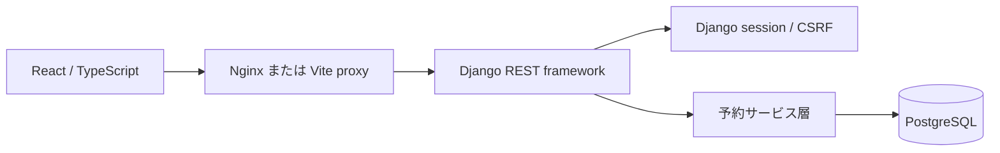
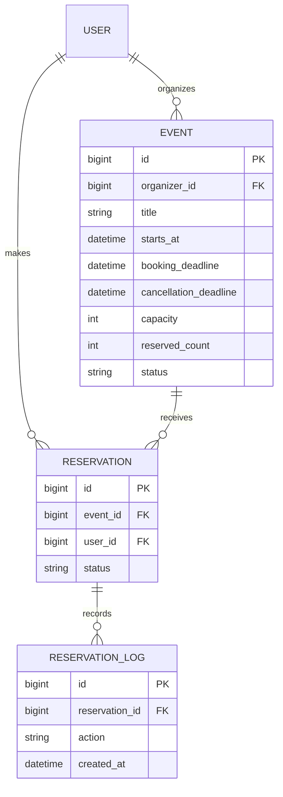

# 構成と設計判断

## 全体構成

APIと画面を同一オリジンで公開する。開発時はVite、ComposeではNginxがAPIをDjangoに転送する。

## ER図

## 1. 予約枠の整合性

イベント行を共通のロック対象にする。予約、キャンセル、定員更新はすべてこの行をロックしてから判断する。トランザクションを付けるだけでは、別の要求が同時に同じ残席を読んでしまうため、明示的にロックする。

予約：イベントをロック → 公開状態・期限・重複・定員を確認 → 予約作成または再有効化 → 人数増加 → 履歴追加 → commit。

キャンセル：本人の予約を特定 → イベントをロック → 予約を再取得 → 取消済みならそのまま返す → 期限を確認 → 状態変更・人数減少・履歴追加 → commit。

イベント行を先にロックする順序を統一し、ロックの順序が逆になる構成を避ける。

## 2. カウンターを持つ理由と注意点

一覧で予約人数を毎回数えずに表示・絞り込みでき、予約時の判定にも利用できる。`reserved_count <= capacity` のDB制約と、1ユーザー1イベントの一意制約を加える。

代わりに、予約更新とカウンター更新は常に同じトランザクションで行う必要がある。adminからの直接編集は不可にした。運用では有効予約数とカウンターの照合が可能。DBを直接手で書き換える運用は想定しない。

## 3. 同一ユーザーの重複と再送

予約行はイベントとユーザーで一意。既存の有効予約への要求は409、キャンセル済み予約への再予約は同じ行を再有効化し履歴を追加する。

キャンセルは再送しても成功状態を返すが、人数と履歴を再度更新しない。これにより通信エラー後の再操作で人数が減りすぎない。

## 4. Cookieセッション認証

ブラウザ向けの同一オリジンアプリなのでDjangoセッションを採用した。認証トークンのlocalStorage保存・更新処理を追加せず、HttpOnlyセッションCookieとCSRFトークンで構成する。未認証のログイン・登録にもCSRF検証を適用する。

## 5. 権限の境界

予約一覧は常に `user=request.user`、主催イベントは `organizer=request.user` の条件を付ける。編集・キャンセル・参加者一覧でも同じ条件で対象を取得する。第三者のIDを指定しても404となる。管理者のモデル権限だけに依存しない。

## 6. 画面とAPIの責任

画面は入力支援・状態表示・再操作を担当し、APIは権限・期限・定員を最終判断する。入力欄のminやボタン非表示を、サーバー側の検証の代わりにしない。フロントはページ別のコンポーネント、共通部品、通信処理に分割した。

## 7. 履歴と削除

予約操作を履歴として保存し、APIからは物理削除しない。ただしイベントのタイトル・日時変更を過去の予約時点へ固定するスナップショット機能は未実装。主催者の変更履歴や通知とともに今後の改善対象とする。
